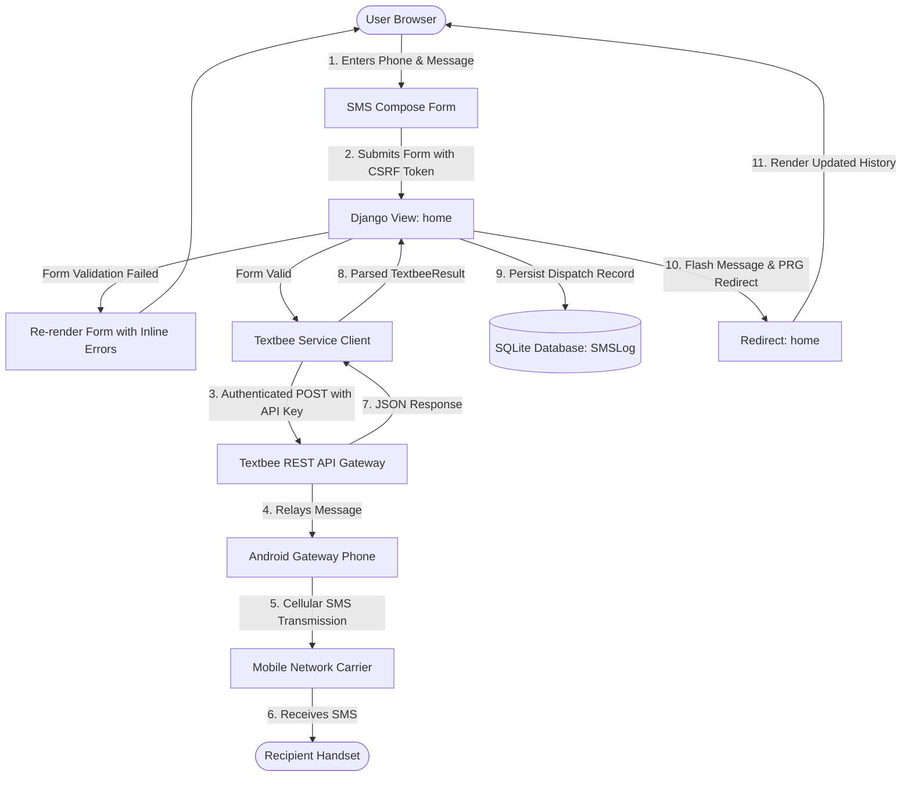

# Django SMS Sender

[](https://www.python.org/)
[](https://www.djangoproject.com/)
[](https://docs.djangoproject.com/en/5.0/topics/testing/)
[](https://textbee.dev)
[](#)

A secure, full-stack **Django SMS Sender** web application developed for **IT 120 (Integrative Programming and Technologies)**. This application enables users to compose, validate, and dispatch real-time Short Message Service (SMS) text messages to mobile phone recipients via the **Textbee REST API Gateway**. The project incorporates multi-tier input validation, resilient error handling, persistent database auditing, an interactive dashboard with live character counting, and a comprehensive 81-test automated test suite.

---

## Table of Contents

- [Project Overview](#project-overview)
- [Individual Role Distribution](#individual-role-distribution)
- [Key Features](#key-features)
- [Technology Stack & Dependencies](#technology-stack--dependencies)
- [Architecture & Workflow](#architecture--workflow)
- [Installation & Setup](#installation--setup)
- [Configuration Guide](#configuration-guide)
- [Running the Application](#running-the-application)
- [Automated Testing & Verification](#automated-testing--verification)
- [Security & Privacy Controls](#security--privacy-controls)
- [Troubleshooting & Known Limitations](#troubleshooting--known-limitations)
- [Academic Information](#academic-information)

---

## Project Overview

The **Django SMS Sender** integrates a clean web interface built with Django 5 and Bootstrap 5 with an external Android-based SMS gateway powered by Textbee. Rather than depending on deprecated or restricted trial SMS services, the system interfaces with the Textbee REST API endpoint, communicating with a registered physical Android gateway device to deliver real SMS messages across Philippine and international cellular networks.

### High-Level System Highlights

- **Modern Web Interface:** Clean, mobile-first design using Bootstrap 5, complete with responsive form elements, inline validation feedback, and dynamic status badges.
- **Strict Data Validation:** Comprehensive client- and server-side validation rejecting invalid phone numbers, empty bodies, and excessive message lengths.
- **Resilient External Service Layer:** Fully isolated HTTP service client with timeout protections, response code handling, and granular error extraction.
- **Audit Logging & History:** Persistent SQLite storage (`SMSLog`) tracking every outbound dispatch attempt with delivery status, gateway batch IDs, and diagnostic error logs.
- **Automated Test Coverage:** 81 automated tests verifying configuration security, form validation, view lifecycles, service failures, database models, and UI rendering.

---

## Individual Role Distribution

To fulfill the requirements of the IT 120 Assignment under an **individual developer model**, development responsibilities were structured across three core functional areas:

| Area | Focus | Key Deliverables & Responsibilities |
| :--- | :--- | :--- |
| **Backend & Architecture** | **Backend Architecture & Data Modeling** | • Project scaffolding (`sms_sender`, `sms_app`) and configuration management.<br>• URL routing design (`sms_sender/urls.py`, `sms_app/urls.py`).<br>• Relational database modeling (`SMSLog` in `sms_app/models.py`) and schema migrations.<br>• Core controller view orchestration (`sms_app/views.py`) implementing the Post/Redirect/Get (PRG) pattern.<br>• Django Admin customization (`sms_app/admin.py`) for audit log inspection. |
| **Frontend & UI** | **Frontend Engineering & UX Design** | • Mobile-first UI templates (`templates/base.html`, `sms_app/templates/sms_app/home.html`).<br>• Bootstrap 5 integration, custom responsive styling, and accessible layout.<br>• Django Form architecture (`SMSComposeForm` in `sms_app/forms.py`) with client/server validation.<br>• Interactive real-time character counter (160-char SMS boundary) with visual badge indicators.<br>• SMS History dashboard table with status badges and error diagnostic tooltips. |
| **Integration & Testing** | **SMS Gateway Integration, Security & Testing** | • Textbee REST API service client (`sms_app/services/textbee.py`) with timeout & error recovery.<br>• Security hardening: `.env` credential isolation, `.gitignore` rules, and CSRF token protection.<br>• Test suite architecture: Authoring 81 automated unit and integration tests (`sms_app/tests.py`).<br>• Comprehensive project documentation and setup guides (`README.md`). |

---

## Key Features

### 1. Robust Multi-Format Phone Number Validation
- Enforces strict regex validation supporting standard Philippine mobile formats (e.g., `09171234567` or `+639171234567`) as well as international E.164 formats (`+[country code][number]`).
- Automatically sanitizes incoming input by stripping extraneous whitespaces and hyphens prior to validation.

### 2. Live Interactive Character Counter
- An embedded JavaScript counter tracks message input in real time.
- Highlights the standard 160-character single-segment SMS boundary with dynamic visual feedback (badge color shifts from neutral to warning/danger as limits approach).

### 3. Post/Redirect/Get (PRG) Pattern & Flash Messages
- Submissions adhere strictly to the PRG pattern, preventing accidental duplicate SMS transmissions if a user refreshes their browser.
- Integrates Django's `messages` framework to render dismissible Bootstrap success and error banners with gateway batch identifiers.

### 4. Resilient External REST Gateway Integration
- Encapsulated service client (`send_sms()`) executing authenticated HTTP POST requests against the Textbee REST API.
- Configured with a 10-second connection and read timeout to prevent thread blocking during network lag.
- Gracefully handles connection drops, timeouts, non-200 HTTP responses, and unexpected JSON payloads without throwing unhandled 500 server errors.

### 5. Persistent Audit Trail & History Dashboard (`SMSLog`)
- Every dispatch attempt—whether successful or failed—is automatically recorded in SQLite with recipient phone number, message text, timestamp, delivery status (`SENT` or `FAILED`), Textbee batch ID, and detailed error messages.
- An embedded **Message History & Audit Log** table displays recent messages directly beneath the composer.
- Failed messages display diagnostic error descriptions detailing the root cause (e.g., missing API credentials, invalid phone format, or gateway timeouts) for immediate troubleshooting.

### 6. Django Admin Integration
- Registered `SMSLogAdmin` interface allowing administrators to search by recipient, filter by dispatch status or date, and review complete message payloads in the back-office portal.

---

## Technology Stack & Dependencies

| Component | Technology | Version / Specification | Purpose |
| :--- | :--- | :--- | :--- |
| **Language** | Python | `3.10+` | Core programming language |
| **Framework** | Django | `5.0+` (compatible with 5.x) | Web application framework and ORM |
| **Configuration** | python-dotenv | `>= 1.0.0` | Environment variable isolation (`.env`) |
| **HTTP Client** | requests | `>= 2.31.0` | Secure communication with Textbee REST API |
| **Frontend** | Bootstrap | `5.3.3` (via CDN) | Responsive grid, components, and form controls |
| **Icons** | Bootstrap Icons | `1.11.3` (via CDN) | Visual iconography for actions and statuses |
| **Database** | SQLite3 | Native Python stdlib | Transactional database for SMS audit records |
| **Testing** | Django Test Runner | `unittest` framework | 81 automated unit and integration tests |

---

## Architecture & Workflow



---

## Installation & Setup

Follow these step-by-step instructions to set up the project on your local machine:

### Prerequisites

Ensure you have the following installed:
- **Python 3.10+** ([python.org](https://www.python.org/downloads/))
- **Git** ([git-scm.com](https://git-scm.com/))
- **Pip** (bundled with Python)

### Step 1: Clone the Repository

```bash
git clone https://github.com/verdenef/it120-django.git
cd it120-django
```

### Step 2: Create and Activate a Virtual Environment

- **On Windows (PowerShell):**
  ```powershell
  python -m venv venv
  .\venv\Scripts\Activate.ps1
  ```
- **On Windows (Command Prompt):**
  ```cmd
  python -m venv venv
  venv\Scripts\activate.bat
  ```
- **On macOS / Linux:**
  ```bash
  python3 -m venv venv
  source venv/bin/activate
  ```

### Step 3: Install Required Dependencies

Install the locked requirements using `pip`:

```bash
pip install -r requirements.txt
```

---

## Configuration Guide

The project utilizes `python-dotenv` to decouple sensitive API keys and environment configurations from source control.

### Step 1: Initialize Environment File

Copy the provided `.env.example` template to `.env`:

- **Windows (PowerShell):**
  ```powershell
  Copy-Item .env.example .env
  ```
- **Windows (CMD):**
  ```cmd
  copy .env.example .env
  ```
- **macOS / Linux:**
  ```bash
  cp .env.example .env
  ```

### Step 2: Configure Environment Variables

Open `.env` in your preferred editor and populate the variables:

```ini
# ==============================================================================
# Django Security Settings
# ==============================================================================
DJANGO_SECRET_KEY=your-custom-secret-key-or-random-string
DEBUG=True
ALLOWED_HOSTS=127.0.0.1,localhost

# ==============================================================================
# Textbee SMS Gateway Configuration
# Obtain credentials from https://textbee.dev
# ==============================================================================
TEXTBEE_API_KEY=your_actual_textbee_api_key_here
TEXTBEE_DEVICE_ID=your_actual_textbee_device_id_here
TEXTBEE_BASE_URL=https://api.textbee.dev/api/v1
```

> [!CAUTION]
> **CRITICAL SECURITY REQUIREMENT:** Never commit your `.env` file to git. The `.gitignore` file is strictly configured to ignore `.env`. Keep your API keys and device IDs strictly private and ensure they do not appear during live screen recordings.

---

## Running the Application

### Step 1: Apply Database Migrations

Apply the Django schema migrations to initialize the SQLite database (`db.sqlite3`):

```bash
python manage.py migrate
```

### Step 2: (Optional) Create an Administrative User

To access the Django Admin portal and review the SMS audit logs:

```bash
python manage.py createsuperuser
```
Follow the interactive prompts to set an admin username, email, and password.

### Step 3: Launch the Development Server

Start the local Django HTTP development server:

```bash
python manage.py runserver
```

### Step 4: Access the Interfaces

- **SMS Dispatcher Web App:** [http://127.0.0.1:8000/](http://127.0.0.1:8000/)
- **Django Admin Portal:** [http://127.0.0.1:8000/admin/](http://127.0.0.1:8000/admin/)

---

## Automated Testing & Verification

The project includes an exhaustive automated test suite comprising **81 test cases** covering every layer of the architecture. All external HTTP calls to Textbee are mocked during test execution to ensure fast, deterministic, and isolated testing without consuming SMS credits or requiring network connectivity.

### Running the Test Suite

Execute the full test suite with standard output:

```bash
python manage.py test
```

For detailed test execution reporting showing individual test classes and methods:

```bash
python manage.py test -v 2
```

### Test Suite Structure & Breakdown (81 Tests)

| Test Class | Focus Area | Test Count | Key Verification Objectives |
| :--- | :--- | :---: | :--- |
| `ConfigurationSecurityTests` | Security & Settings | 3 | Verifies safe default `SECRET_KEY`, CSRF protection middleware enabled, and Textbee gateway configuration attributes present in settings. |
| `ViewSmokeTests` | Routing & Views | 2 | Verifies root URL resolves with HTTP 200, loads base and home templates, and shields sensitive credentials from response HTML. |
| `SMSComposeFormTests` | Form Validation | 18 | Validates required fields, Philippine mobile regex (`09XXXXXXXXX`, `+639...`), international E.164, space/hyphen cleaning, 160-char length limits, and edge cases. |
| `SMSComposeViewTests` | View Lifecycle & PRG | 17 | Validates GET requests, invalid POST handling, valid POST dispatch triggering `send_sms`, PRG redirect to `home`, flash messages, and CSRF token presence. |
| `SMSComposeTemplateUITests` | Template & Controls | 7 | Verifies rendering of form input tags, Bootstrap `is-invalid` states, inline error messages, character counter span, submit button, and CSRF hidden field. |
| `TextbeeServiceTests` | Gateway Service Client | 22 | Tests missing API key, missing device ID, 10-second request timeouts, network connection drops, HTTP 400/401/403/500 errors, JSON responses, and batch ID extraction. |
| `SMSLogModelTests` | Database Modeling | 4 | Verifies model creation, field attributes, `SENT`/`FAILED` status choices, default ordering (`-created_at`), and string formatting. |
| `SMSLogViewIntegrationTests` | End-to-End Integration | 5 | Validates full pipeline: form POST -> service execution -> database logging (`SENT` or `FAILED` record creation with batch ID or error message). |
| `SMSLogUIRenderingTests` | History Dashboard UI | 3 | Verifies empty state placeholder, populated table rows, status badge styling (success/danger), and error popover/tooltip attributes. |

**Current Test Result:** `Ran 81 tests in 0.110s — OK (0 failures, 0 errors)`.

---

## Security & Privacy Controls

The application enforces defense-in-depth security principles aligning with both the IT 120 rubric and modern web development standards:

1. **Credential Decoupling & Isolation:** All sensitive credentials (`TEXTBEE_API_KEY`, `TEXTBEE_DEVICE_ID`, `DJANGO_SECRET_KEY`) reside exclusively in `.env` and are loaded via `python-dotenv`.
2. **Repository Hygiene:** The `.gitignore` file excludes `.env`, `db.sqlite3`, `__pycache__`, and virtual environment directories to prevent accidental credential or database leakage.
3. **Cross-Site Request Forgery (CSRF) Protection:** All POST requests are safeguarded by Django's `CsrfViewMiddleware` and verified through encrypted CSRF tokens embedded within the form template (``).
4. **SQL Injection Defense:** All database interactions are executed strictly through Django ORM parameterized queries; raw SQL is never utilized.
5. **Cross-Site Scripting (XSS) Prevention:** Output rendering in Django templates leverages automatic HTML entity escaping, neutralizing malicious scripts submitted in phone numbers or message bodies.
6. **Fault Isolation & Error Redaction:** The external service client catches network and HTTP exceptions internally, translating raw errors into sanitized status objects without exposing internal stack traces or API keys to the client.

---

## Troubleshooting & Known Limitations

### Troubleshooting Common Issues

#### 1. "Failed to send SMS: Missing API Key"
- **Cause:** `TEXTBEE_API_KEY` is empty or not configured in your `.env` file.
- **Solution:** Verify that your `.env` file exists in the project root and contains a valid API key from your Textbee dashboard.

#### 2. "Failed to send SMS: Missing Device ID"
- **Cause:** `TEXTBEE_DEVICE_ID` is unset.
- **Solution:** Ensure your Android phone is linked to your Textbee account and paste the assigned Device ID into `.env`.

#### 3. "Request timed out after 10 seconds"
- **Cause:** Network latency between your local server and Textbee, or Textbee is experiencing downtime.
- **Solution:** Verify your internet connection. Check Textbee server status and ensure the Android gateway device is awake and connected to Wi-Fi/mobile data.

#### 4. "Textbee gateway returned HTTP 401: Unauthorized"
- **Cause:** The provided `TEXTBEE_API_KEY` is invalid or expired.
- **Solution:** Regenerate your API key in the Textbee dashboard and update your `.env` file.

### Known Limitations

- **Physical Android Gateway Requirement:** Textbee operates by relaying API requests to a designated Android smartphone running the Textbee companion app. The phone must remain powered on, connected to the internet, and have an active cellular SIM card with SMS credits/allowance.
- **Carrier Delivery Speeds:** While API dispatch is near-instantaneous (typically < 1 second), actual SMS receipt depends on cellular carrier queuing and recipient device signal.
- **Rate Limits:** Free Textbee tiers or cellular carriers may impose daily or hourly SMS throughput limits.

---

## Academic Information

This project is submitted in fulfillment of the coursework requirements for **IT 120 (Integrative Programming and Technologies)**. 

- **Academic Integrity:** Developed solely for educational and demonstrative purposes. All code, documentation, and automated tests reflect original work adhering to academic standards.
- **Developer:** Solo Project Development.
